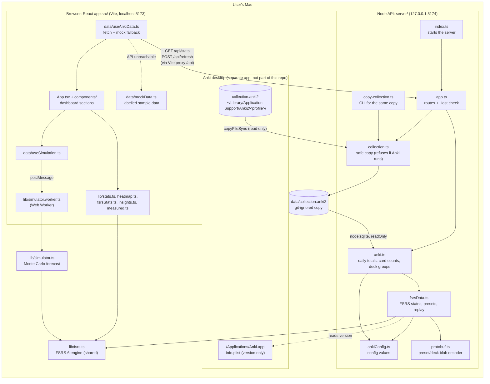
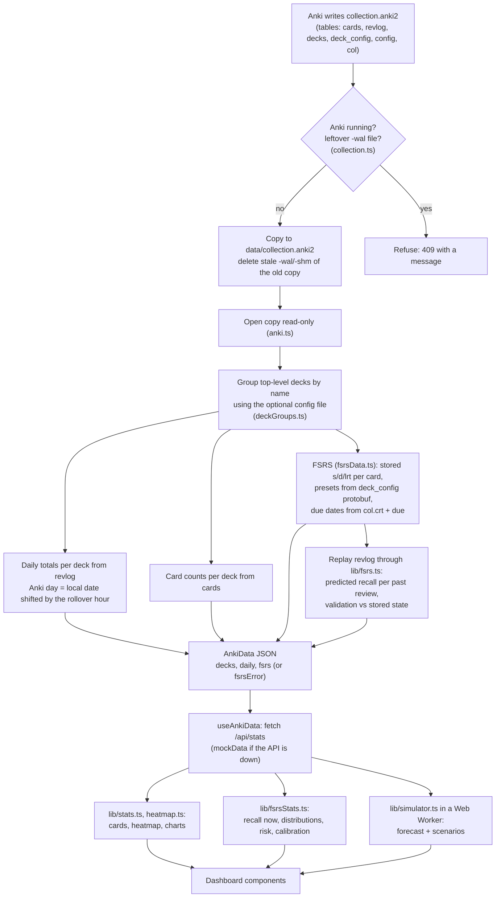
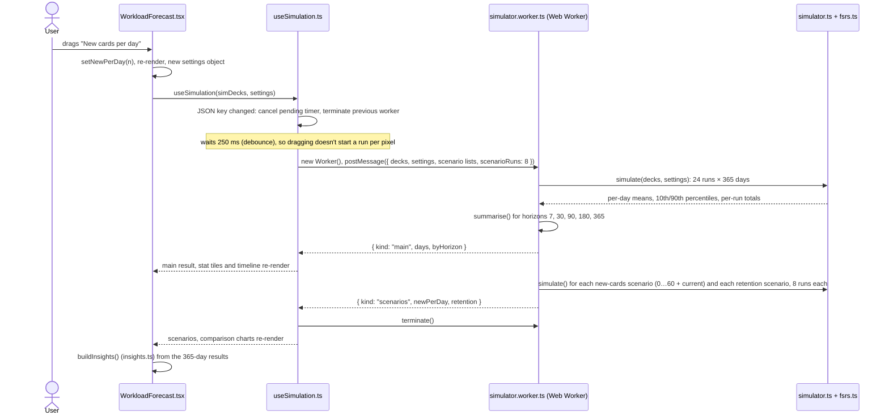

# Architecture

How Anki Analytics is actually built, based on the source code in this repository (branch
`feature/fsrs-forecast`). Everything under "Implemented today" exists in the code; anything planned is
listed separately under "Not implemented".

## In one paragraph

A single-user app that runs on one Mac. A small Node.js server (`server/`) copies the Anki collection
file into the project's `data/` folder, reads that copy with Node's built-in SQLite (read-only), and
serves one JSON document over HTTP on `127.0.0.1:5174`. A React app (`src/`), served by the Vite dev
server on `localhost:5173`, fetches that JSON through Vite's proxy and computes everything else in the
browser: dashboard statistics, FSRS memory metrics, and a Monte Carlo workload forecast that runs in a
Web Worker. There is no database server, no accounts and no cloud component.

## 1. System architecture

**API endpoints** (all in `server/app.ts`, which answers only when the Host header is `localhost`, `127.0.0.1` or `[::1]`):

| Method & path | What it does | Responses |
|---|---|---|
| `GET /api/stats` | Reads `data/collection.anki2` and returns one `AnkiData` JSON document (`src/data/types.ts`) | 200, 503 (no copy yet), 500 |
| `POST /api/refresh` | Requires header `X-Requested-By: anki-analytics`; re-copies the collection from Anki, then returns fresh `AnkiData` | 200, 403, 409 (Anki open / bad profile), 500 |
| anything else | | 404 (403 for a foreign Host) |

The browser never talks to port 5174 directly: `vite.config.ts` proxies `/api` to `http://127.0.0.1:5174`.

**There is no database server.** The only "database" is the SQLite file Anki itself writes; this app
reads a copy of it. Nothing is stored by the app apart from that copy (and the browser keeps nothing).

## 2. Data flow: from Anki to the dashboard

What is **measured**, **calculated** and **estimated**:

| Data | Origin |
|---|---|
| Reviews, Again rate, study time, heatmap, card counts | Measured: counted from `revlog` and `cards` |
| Stability, difficulty, last review | Measured: Anki's stored FSRS state (`cards.data`) |
| Recall probability now, past predictions | Calculated: FSRS-6 formulas in `src/lib/fsrs.ts` |
| Forecast and insights | Estimated: simulation in `src/lib/simulator.ts` |
| Mock data | Generated by `src/data/mockData.ts`, only when the API is unreachable, and labelled |

## 3. Changing the "new cards per day" slider

Moving the slider never contacts the server. Everything happens in the browser.

Notes from the code:
- The simulation always covers 365 days (`SIM_DAYS`); shorter horizons are the first days of the same run,
  so switching horizon doesn't re-run anything.
- Every run uses the same seed (`seed: 20261103` in `WorkloadForecast.tsx`), so scenario differences come
  from the setting, not from chance.
- If the worker throws, `useSimulation` shows an error; if nothing is selectable, it shows "Nothing to simulate".

## 4. Source files and their responsibilities

### Server (`server/`, Node 22.18+, TypeScript run directly)

| File | Responsibility |
|---|---|
| `index.ts` | Starts the API on `127.0.0.1:5174` |
| `app.ts` | Request routing, Host-header check, refresh header check, error responses; dependencies are injectable for tests |
| `collection.ts` | Finds the Anki profile, refuses while Anki runs (`pgrep`) or after an unclean exit, copies `collection.anki2` to `data/` |
| `copy-collection.ts` | `npm run copy-collection` command-line wrapper around `collection.ts` |
| `anki.ts` | Opens the copy read-only; deck grouping/exclusion; daily review totals; card counts; calls `fsrsData.ts` and isolates its failures |
| `fsrsData.ts` | FSRS data: stored memory states, due dates, presets, reset counts, measured answer behaviour, review-log replay (calibration and validation) |
| `protobuf.ts` | Minimal, bounds-checked reader for Anki's protobuf settings blobs |
| `ankiConfig.ts` | Reads JSON values from Anki's `config` table without throwing |

### Shared contract

| File | Responsibility |
|---|---|
| `src/data/types.ts` | The `AnkiData` shape the API returns and the mock data follows |
| `src/lib/dates.ts` | Anki-day and day-number helpers (no imports, used by server and browser) |
| `src/lib/fsrs.ts` | FSRS-6 engine: forgetting curve, intervals, memory-state updates, replay (no imports, used by both) |

### Browser (`src/`)

| File | Responsibility |
|---|---|
| `main.tsx`, `App.tsx` | Entry point; picks the section from the URL hash, lazy-loads chart-heavy sections |
| `app/AppShell.tsx` | Header, desktop and mobile navigation, data-source chip and sample banner, refresh, loading screen |
| `app/useTheme.ts`, `app/useRoute.ts`, `app/ErrorBoundary.tsx` | Light/dark/system theme, hash routing, per-section error state |
| `pages/*.tsx` | Home, Activity, Planner and Advanced pages; `FsrsGate.tsx` is the empty state without FSRS data |
| `i18n/en.ts`, `i18n/index.ts` | Interface text (typed) and locale |
| `lib/progress.ts` | Home: longest streak, week comparison, milestones, status, one insight |
| `lib/route.ts` | Section names and URL hashes |
| `data/useAnkiData.ts` | Fetches `/api/stats`, falls back to mock data, runs `POST /api/refresh` |
| `data/useSimulation.ts` | Starts, debounces and cancels Web Worker runs |
| `data/mockData.ts` | Seeded sample data (no FSRS data) |
| `lib/stats.ts` | Ranges, totals, streaks, Again rate, retention, grouping by day/week/month |
| `lib/heatmap.ts` | Heatmap grid and colour levels |
| `lib/fsrsStats.ts` | Current retrievability, distributions, risk, retention vs target, calibration, lapse evidence |
| `lib/simulator.ts` | Monte Carlo forecast, scenario values, horizon summaries |
| `lib/simulator.worker.ts` | Runs the simulator off the main thread |
| `lib/insights.ts` | The four plain-language insights, from simulator output |
| `lib/measured.ts` | Simulator defaults measured from recent reviews |
| `lib/fsrsStatus.ts` | Why FSRS sections are hidden (mock, error, missing, FSRS off) |
| `lib/format.ts`, `lib/theme.ts` | Number/date formatting; chart and deck colours (as CSS variables from `index.css`) |
| `components/StatCard.tsx`, `RangeFilter.tsx`, `ActivityHeatmap.tsx`, `DailyReviewsChart.tsx`, `DeckComparison.tsx` | Key numbers and Activity charts |
| `components/FsrsAnalytics.tsx` | FSRS memory section (measured) |
| `components/WorkloadForecast.tsx` | Forecast controls, charts and insights (projection) |
| `components/Panel.tsx`, `ChartTooltip.tsx`, `ui.tsx`, `icons.tsx` | Shared cards, tooltip, controls, badges, disclosure, empty states, count-up, hatch pattern, inline SVG icons |

### Tests (Vitest)

`server/anki.test.ts` (reader, against a synthetic SQLite fixture), `server/app.test.ts` (HTTP),
`src/lib/*.test.ts` (FSRS, simulator, stats, heatmap, insights, measured defaults, FSRS status, Home progress, routes, formatting).
`src/lib/fsrs.test.ts` also checks the FSRS engine against reference states exported from Anki's own
engine for synthetic histories (`src/lib/fixtures/anki-fsrs-reference.json`).
No React component or end-to-end tests exist yet.

### Validation scripts (`scripts/fsrs-validation/`, run by hand)

`anki_export.py` runs Anki's bundled engine on a temporary copy of the collection; `compare.ts` compares
it with this app's replay, calibration and simulator; `anki_reference.py` regenerates the test fixture.
Results are in `docs/fsrs-validation.md`.

## 5. Implemented today vs not implemented

| Area | Implemented today | Not implemented (would be needed for a multi-user SaaS) |
|---|---|---|
| Users | One person, one Mac | Accounts, sign-in, sessions |
| Data intake | Copy of a local Anki profile (`~/Library/Application Support/Anki2`, macOS only) | Upload of Anki exports (`.colpkg`/`.apkg`, compressed `collection.anki21b`), schema-version checks, other OSes |
| Storage | One file, `data/collection.anki2`, overwritten on refresh | Per-user storage, encryption at rest, retention and deletion, storing derived results instead of raw collections |
| Configuration | Deck groups and exclusions in a git-ignored local config file (`anki-analytics.config.json`) | Per-user deck settings stored as data |
| Computation | Whole collection re-read and replayed on every `GET /api/stats` (~0.5 s, blocks the server) | Caching, background jobs, horizontal scaling |
| Security | Binds to 127.0.0.1, Host-header allowlist, refresh header, read-only SQLite | Authentication, authorisation, tenant isolation, rate limits, TLS, audit logging |
| Deployment | `npm run dev` (Vite dev server + Node API) | Production hosting, a production server for the built app, monitoring, backups |
| Quality | Unit, integration and page tests (Vitest), browser smoke tests (Playwright) | CI |

## 6. Weaknesses and risks

- **Single-user by construction.** File paths, the Anki-process check (`pgrep`), the version check
  (`/Applications/Anki.app`) and the local config file are specific to one person's Mac. A SaaS needs a different
  data-intake path, not just more servers.
- **Recomputed on every request.** `GET /api/stats` reads the full `revlog` and replays every card
  synchronously (`server/fsrsData.ts`), blocking the Node event loop. Fine for one user, not for many.
- **The browser receives detailed data.** Per-card FSRS states are sent to the client. Acceptable locally;
  for other people's data it raises privacy and payload-size questions.
- **The forecast is a model.** It assumes FSRS-6 default parameters (your presets have none optimised), and
  FSRS's predictions can be badly calibrated for a collection that uses them. Any such gap comes from the default parameters, not from the calculations: the replay matches Anki's
  own engine exactly, and Anki's evaluator reports the same mis-calibration (`docs/fsrs-validation.md`).
  It does not model lapses during learning steps, Anki's load balancing or easy days, and review limits are
  applied per deck group, not through Anki's deck hierarchy. Compared with Anki's built-in simulator, review
  counts agree within about 15% for existing cards and differ by up to about 35% over a year with new cards.
- **Dependence on Anki's internal format.** The reader relies on undocumented details (protobuf field
  numbers, the `cards.data` JSON, due-number conventions). They were checked against this collection and
  Anki 26.9.3, and the reader degrades gracefully, but a future Anki version could change them.
- **Dev-server deployment.** The app runs on Vite's development server; there is no production server
  setup, and `npm run dev` relies on the shell's `&`, which doesn't work on Windows.
- **Browser tests are smoke tests.** Playwright covers rendering, layout and data states on synthetic data.
  Chart contents and the real Web Worker's results are still checked by hand.
